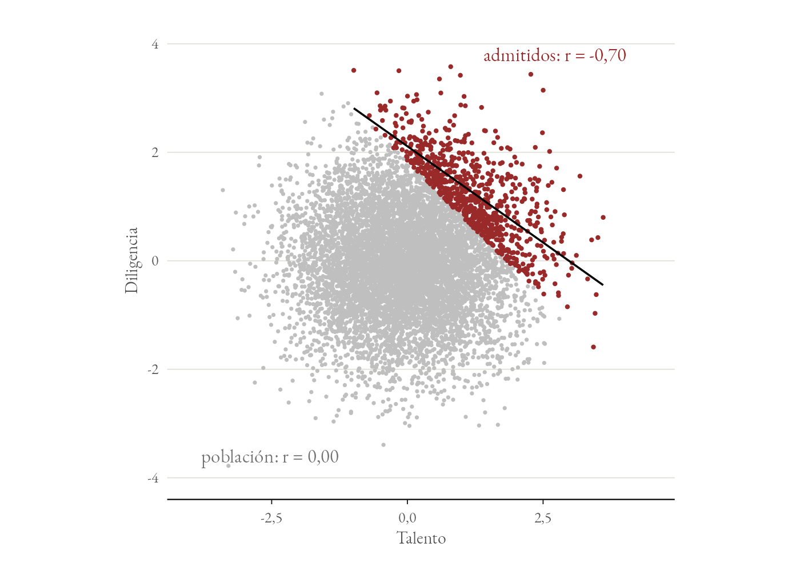
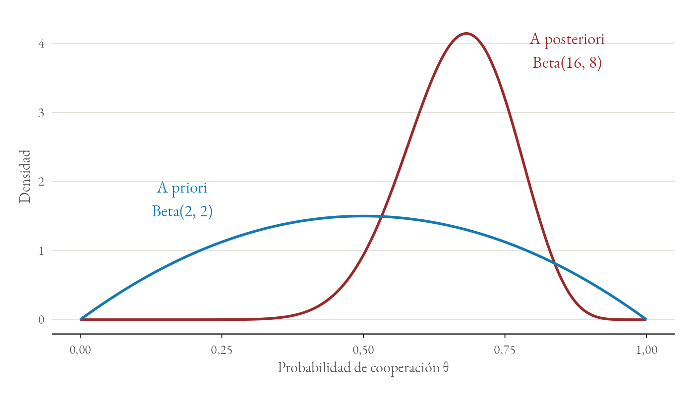
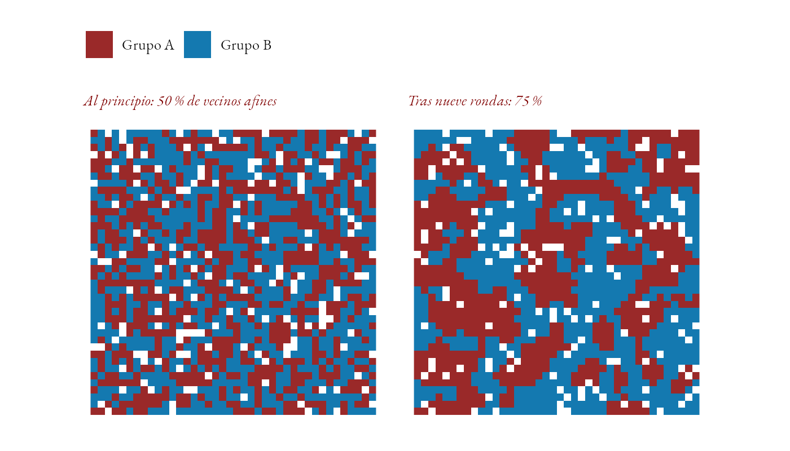
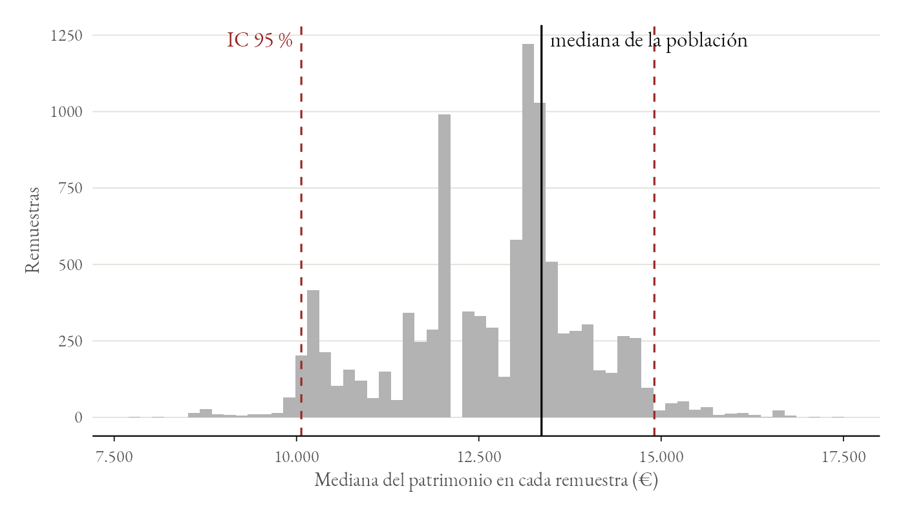

::: {.callout-note}
## El código como microscopio social
Un mecanismo generativo se entiende de verdad cuando se deriva desde primeros principios y se ejecuta sobre datos. Estos cinco laboratorios son una muestra de cómo se trabaja en la Nueva Somosaguas: cada uno aísla un mecanismo clásico, enseña lo que produce y guarda debajo el código que lo produce.

Están escritos en **Julia** —modelado dinámico, inferencia y simulación— y en **SQL relacional**, sin librerías de caja negra: la mecánica algorítmica queda a la vista, que es justamente lo que se quiere enseñar. Cualquiera puede pegarlos en un REPL de Julia o en un cliente SQLite y verificarlos en segundos. Al final de cada uno hay un enlace para seguir tirando del hilo.
:::

---

## 1. El sesgo de colisionador: la paradoja de Berkson

Sean dos rasgos independientes en la población general: el talento analítico ($T$) y la diligencia ($D$). Un comité de admisiones selecciona solo a quienes superan cierto umbral de rendimiento combinado ($S = 1$). La selección es un *colisionador*: la causan a la vez el talento y la diligencia, $T \rightarrow S \leftarrow D$. Un colisionador bloquea por sí mismo el camino entre sus causas, y por eso en la población $T$ y $D$ siguen siendo independientes. Condicionar en él, quedarse solo con los admitidos, abre ese camino: entre ellos, quien no destaca en talento ha tenido que compensarlo con un esfuerzo desmedido.

{fig-alt="Nube de puntos de talento frente a diligencia. La nube gris de la población es redonda; los admitidos, en granate, ocupan la esquina superior derecha y forman una banda descendente."}

**Explicación analítica:** la correlación poblacional es nula, como corresponde a dos variables generadas de forma independiente. Al restringir la muestra al decil superior aparece una correlación de $r \approx -0{,}70$. Nada causal ha ocurrido entre $T$ y $D$: el sesgo lo introduce el propio acto de seleccionar por una variable que ambas causan.

::: {.callout-tip collapse="true" icon="false"}
## El código, en Julia
```julia
using Random, Statistics

Random.seed!(42)
N = 100_000

# 1. Dos rasgos independientes en la población general
talento = randn(N)
diligencia = randn(N)

r_pob = cor(talento, diligencia)
println("Correlación poblacional verdadera: ", round(r_pob, digits = 4))

# 2. La selección S es un colisionador: la causan los dos rasgos.
#    Entra el decil superior de la puntuación combinada.
puntuacion = talento .+ diligencia
umbral = quantile(puntuacion, 0.90)
seleccionados = puntuacion .>= umbral

# 3. Condicionar en S == 1 abre el camino entre talento y diligencia
r_muestra = cor(talento[seleccionados], diligencia[seleccionados])
println("Correlación en la muestra condicionada: ", round(r_muestra, digits = 4))
```
:::

**Para profundizar:** [encuentra el error de un análisis como este](https://nuevasomosaguas.github.io/laboratorios-y-simulaciones/problemas/03-berkson/), en R y en el navegador.

---

## 2. Actualización conjugada Beta-Binomial

El análisis bayesiano trata la probabilidad de cooperación $\theta$ como una cantidad incierta y actualiza lo que se sabe de ella conforme llega la evidencia. Si la creencia previa se parametriza como $\text{Beta}(\alpha, \beta)$, observar $k$ éxitos en $n$ interacciones actualiza la posterior a $\text{Beta}(\alpha + k,\ \beta + n - k)$ de forma analítica y exacta, sin muestreo.

{fig-alt="Dos curvas de densidad: la previa Beta(2, 2), baja y ancha, centrada en 0,5; y la posterior Beta(16, 8), alta y estrecha, con el máximo cerca de 0,68."}

**Explicación analítica:** la media pasa de $0{,}5$ a $16/24 = 0{,}667$, y la incertidumbre se estrecha. La conjugación Beta-Binomial permite escribir la posterior en forma cerrada, de modo que el resultado no depende de ningún muestreador ni de su convergencia.

::: {.callout-tip collapse="true" icon="false"}
## El código, en Julia
```julia
# A priori: una creencia débil, centrada en 0,5
α_0, β_0 = 2, 2

# Datos: 14 jugadas cooperativas en 20 rondas
k, n = 14, 20

# Actualización conjugada
α_post = α_0 + k
β_post = β_0 + (n - k)

media_prior = α_0 / (α_0 + β_0)
media_post  = α_post / (α_post + β_post)

println("Media a priori de cooperación: ", round(media_prior, digits = 3))
println("Media a posteriori actualizada: ", round(media_post, digits = 3))

# La densidad Beta, escrita a mano. Con parámetros enteros, la constante de
# normalización no necesita la función gamma: 1/B(a,b) = (a+b-1) * binomial(a+b-2, a-1).
pdf_beta(θ, a, b) = θ^(a - 1) * (1 - θ)^(b - 1) * (a + b - 1) * binomial(a + b - 2, a - 1)
println("Densidad posterior en θ=0.65: ", round(pdf_beta(0.65, α_post, β_post), digits = 4))
```
:::

**Para profundizar:** la [semana 6 del bootcamp](https://nuevasomosaguas.github.io/bootcamp/semanas/semana-06/), probabilidad, inferencia bayesiana y simulación Monte Carlo.

---

## 3. El modelo de segregación espacial de Schelling

Ningún agente desea vivir en un gueto homogéneo: solo prefiere no ser una minoría extrema en su vecindario inmediato. Basta con esa microtolerancia para que la reubicación sucesiva de los insatisfechos desencadene una cascada de externalidades que convierte una mezcla aleatoria en una segregación casi total.

{fig-alt="Dos cuadrículas de casillas granates, azules y blancas. En la primera los colores están mezclados al azar; en la segunda forman grandes manchas de un solo color."}

**Explicación analítica:** el umbral es del 30 %, es decir, cada agente acepta ser minoría en una proporción de dos a uno. Aun así el índice de segregación —la proporción media de vecinos afines— pasa de $0{,}504$, el valor esperado en una distribución aleatoria, a $0{,}753$ en nueve iteraciones. Nadie ha buscado el gueto; lo produce la agregación de decisiones locales, que es exactamente la tesis generativa de Schelling y Joshua Epstein.

::: {.callout-tip collapse="true" icon="false"}
## El código, en Julia
```julia
using Random, Statistics

"""Proporción de vecinos ocupados (vecindad de Moore) del mismo grupo que el agente."""
function prop_vecinos_iguales(tablero, r, c)
    dim = size(tablero, 1)
    agente = tablero[r, c]
    iguales = 0
    ocupados = 0
    for i in max(1, r - 1):min(dim, r + 1), j in max(1, c - 1):min(dim, c + 1)
        (i == r && j == c) && continue      # un agente no es vecino de sí mismo
        tablero[i, j] == 0 && continue      # se saltan las casillas vacías
        ocupados += 1
        tablero[i, j] == agente && (iguales += 1)
    end
    return ocupados == 0 ? nothing : iguales / ocupados
end

"""Proporción media de vecinos del mismo grupo, sobre todos los agentes del tablero."""
function indice_segregacion(tablero)
    props = Float64[]
    for ci in CartesianIndices(tablero)
        tablero[ci] == 0 && continue
        p = prop_vecinos_iguales(tablero, Tuple(ci)...)
        p === nothing || push!(props, p)
    end
    return mean(props)
end

function simular_schelling(dim = 40; vacios = 0.1, umbral = 0.30, max_iter = 50)
    # Estados: 0 = vacía, 1 = grupo A, 2 = grupo B
    n_celdas = dim * dim
    tablero = rand([1, 2], dim, dim)
    tablero[randperm(n_celdas)[1:round(Int, vacios * n_celdas)]] .= 0
    println("Índice de segregación inicial: ", round(indice_segregacion(tablero), digits = 3))

    for paso in 1:max_iter
        movimientos = 0
        celdas_vacias = findall(==(0), tablero)

        for ci in CartesianIndices(tablero)
            tablero[ci] == 0 && continue
            isempty(celdas_vacias) && break
            p = prop_vecinos_iguales(tablero, Tuple(ci)...)
            if p !== nothing && p < umbral
                destino = popat!(celdas_vacias, rand(1:length(celdas_vacias)))
                tablero[destino] = tablero[ci]
                tablero[ci] = 0
                push!(celdas_vacias, ci)
                movimientos += 1
            end
        end

        if movimientos == 0
            println("Convergencia alcanzada en la iteración ", paso)
            break
        end
    end
    return tablero
end

Random.seed!(7)
tablero_final = simular_schelling()
println("Índice de segregación final:   ", round(indice_segregacion(tablero_final), digits = 3))
```
:::

**Para profundizar:** [una versión del modelo en R](https://nuevasomosaguas.github.io/laboratorios-y-simulaciones/problemas/05-schelling/), en el navegador, para cambiar el umbral y ver qué pasa.

---

## 4. Tabla de mortalidad en SQL relacional

Una tabla de mortalidad de cohorte se puede calcular dentro de la propia base de datos, sin exportar nada a una hoja de cálculo. La consulta deriva la función de supervivencia $l(x)$ y la probabilidad condicional de muerte $q(x)$ a partir de un registro bruto de defunciones, por el método de la cohorte extinguida: cuando todos los nacidos en 1680 han muerto, los que sobreviven a la edad $x$ son exactamente los que murieron a esa edad o después.

```sql
-- SQLite: tabla de mortalidad de la cohorte de 1680, a partir de los registros parroquiales
WITH RECURSIVE
-- Las defunciones de la cohorte, por edad
defunciones AS (
    SELECT edad_fallecimiento AS x, COUNT(*) AS dx
    FROM registros_parroquiales
    WHERE cohorte_nacimiento = 1680
    GROUP BY edad_fallecimiento
),
-- Todas las edades, de 0 a la máxima, también las que no tienen ninguna defunción
edades(x) AS (
    SELECT 0
    UNION ALL
    SELECT x + 1 FROM edades WHERE x < (SELECT MAX(x) FROM defunciones)
),
serie AS (
    SELECT edades.x, COALESCE(defunciones.dx, 0) AS dx
    FROM edades LEFT JOIN defunciones USING (x)
),
-- Supervivientes a la edad x: los que mueren a esa edad o después
tabla AS (
    SELECT
        x,
        dx,
        SUM(dx) OVER (ORDER BY x ROWS BETWEEN CURRENT ROW AND UNBOUNDED FOLLOWING) AS lx
    FROM serie
)
SELECT
    x AS edad,
    lx AS supervivientes_lx,
    dx AS defunciones_dx,
    ROUND(CAST(dx AS REAL) / lx, 4) AS probabilidad_muerte_qx
FROM tabla
ORDER BY edad;
```

**Explicación analítica:** la CTE recursiva genera la serie completa de edades. Sin ella, las edades en las que no murió nadie desaparecerían de la tabla, y la tabla saltaría de una edad a otra. La función de ventana acumula las defunciones desde cada edad hasta el final, y de ahí sale $l(x)$; la probabilidad condicional $q(x) = d(x) / l(x)$ sale ya como columna, lista para alimentar una matriz de Leslie.

**Las trampas de los registros parroquiales.** El método supone que se registran todas las muertes de la cohorte, y no es así: quien emigraba de la parroquia moría fuera de sus libros, y la tabla lo da por inmortal hasta que se le pierde la pista. Además, las edades declaradas al morir eran a menudo aproximadas, y se amontonan en los múltiplos de cinco y de diez. Es el problema que resuelve la *reconstrucción de familias* de Louis Henry, que enlaza bautismos, matrimonios y entierros de cada familia, calcula las edades a partir de la fecha de bautismo y solo cuenta a las personas mientras se sabe que siguen en la parroquia. Wrigley, Schofield y sus colegas la aplicaron a 26 parroquias inglesas para reconstruir la demografía de Inglaterra entre 1580 y 1837.

Fleury, M. y Henry, L. (1956). *Des registres paroissiaux à l'histoire de la population: manuel de dépouillement et d'exploitation de l'état civil ancien*. INED.

Wrigley, E. A., Davies, R. S., Oeppen, J. E. y Schofield, R. S. (1997). *English Population History from Family Reconstitution, 1580–1837*. Cambridge University Press.

**Para profundizar:** la [semana 9 del bootcamp](https://nuevasomosaguas.github.io/bootcamp/semanas/semana-09/), en la que se replica la tabla de vida del INE con los microdatos de defunciones.

---

## 5. Intervalos de confianza por bootstrap

Al estudiar rentas, patrimonios o ratios de fecundidad —distribuciones con cola pesada— suponer normalidad es un error de bulto. El remuestreo de Efron reconstruye la distribución muestral del estimador extrayendo muestras con reemplazo de los propios datos, sin postular nada sobre su forma.

{fig-alt="Histograma irregular de las medianas remuestreadas, entre 8000 y 17 000 euros, con dos líneas discontinuas que marcan el intervalo y una línea continua en la mediana de la población, dentro del intervalo."}

**Explicación analítica:** la mediana de una lognormal es $e^{\mu}$, aquí $e^{9{,}5} \approx 13\,360$. La mediana muestral es $13\,055{,}63$ y el intervalo percentil al 95 % resulta $[10\,065{,}89;\ 14\,907{,}10]$, que cubre el valor poblacional. Se construye sin fórmula cerrada y sin suponer simetría, que es lo que lo hace utilizable sobre datos reales de patrimonio. El histograma es irregular porque la mediana de una remuestra solo puede tomar unos pocos valores de la muestra original, los del centro.

::: {.callout-tip collapse="true" icon="false"}
## El código, en Julia
```julia
using Random, Statistics

Random.seed!(101)
B = 10_000                       # réplicas bootstrap

# Muestra asimétrica: una lognormal de cola pesada
patrimonio = exp.(randn(200) .* 1.2 .+ 9.5)

mediana_observada = median(patrimonio)
n = length(patrimonio)

medianas_boot = zeros(B)
for b in 1:B
    remuestra = patrimonio[rand(1:n, n)]
    medianas_boot[b] = median(remuestra)
end

# Intervalo percentil al 95 %
ic_inferior = quantile(medianas_boot, 0.025)
ic_superior = quantile(medianas_boot, 0.975)

println("Mediana muestral: ", round(mediana_observada, digits = 2))
println("IC 95% bootstrap: [", round(ic_inferior, digits = 2), ", ",
        round(ic_superior, digits = 2), "]")
```
:::

---

## Para seguir

Este muestrario es la puerta. Lo práctico de la Nueva Somosaguas continúa en tres niveles:

- **[Los problemas interactivos](https://nuevasomosaguas.github.io/laboratorios-y-simulaciones/)**, en R y en el navegador, sin instalar nada: ejercicios cortos con su comprobación, de la paradoja de Simpson al modelo de Kuran.
- **[El bootcamp](bootcamp.qmd)**: doce semanas en Julia, cada una con un laboratorio que se corrige solo.
- **[El proyecto de replicación](https://nuevasomosaguas.github.io/bootcamp/semanas/semana-12/)**: una comunidad autónoma, de los microdatos al informe.

Las figuras de esta página salen del mismo código, con las mismas semillas: `images/laboratorios/figuras.jl` repite los laboratorios y `figuras.R` las dibuja.
